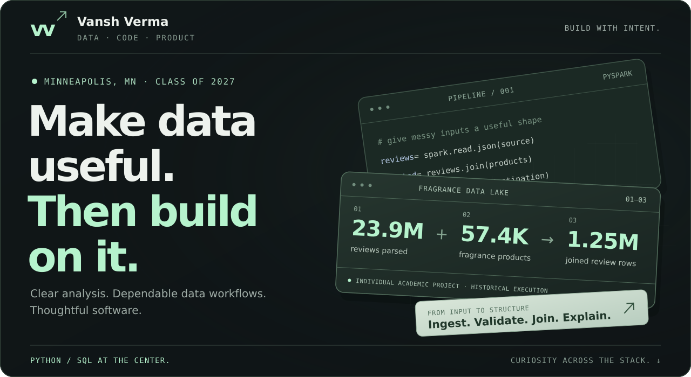
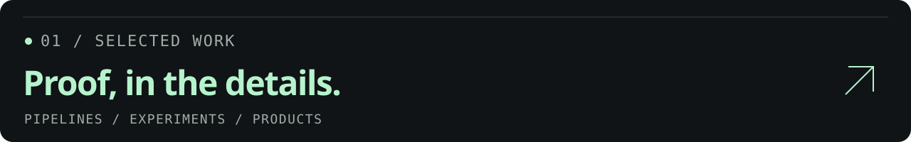
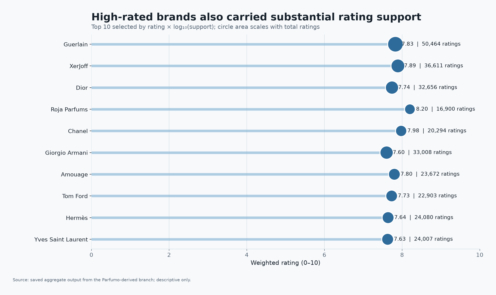
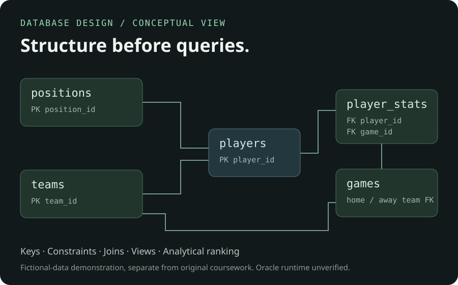
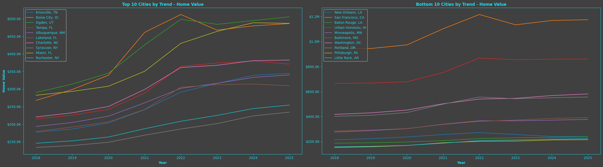
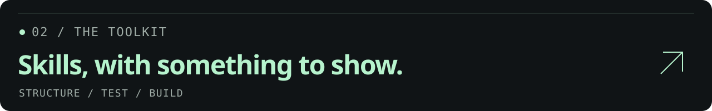
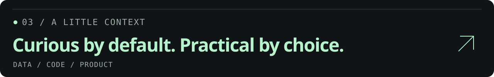

<picture>
  <source media="(max-width: 600px)" srcset="assets/profile/portfolio-hero-mobile.svg">
  
</picture>

<a href="#selected-work"><strong>01 &nbsp; Work ↓</strong></a> &nbsp; · &nbsp; <a href="#the-toolkit"><strong>02 &nbsp; Toolkit ↓</strong></a> &nbsp; · &nbsp; <a href="#about"><strong>03 &nbsp; About ↓</strong></a> &nbsp; · &nbsp; <a href="https://vanshverma0401-wq.github.io/vanshverma0401-wq/"><strong>Interactive portfolio ↗</strong></a>

I’m Vansh, an **M.S. Data Science student** looking for **data engineering and analytics engineering roles from June 2027**. I build Python and SQL pipelines, Snowflake/dbt models and PySpark data lakes, and each repo states what it proves and what it doesn’t.

**University of St. Thomas · 4.0/4.0 GPA · Expected May 2027** 
Minneapolis, MN · Open to relocation anywhere in the U.S.

## Selected work

<table>
<tr>
<td width="44%" valign="top">
01 / FEATURED · DATA ENGINEERING &amp; AI
<h2>Zomato AI Data Pipeline</h2>

Private S3 CSVs → Snowflake → tested dbt models, orchestrated through a manual Airflow workflow in Docker.

<h3>17 models · 28 passing data tests</h3>

10,000,000 generated orders 22,998,179 generated order items.

<strong>Python · SQL · Snowflake · dbt Airflow · Docker · Hosted OpenAI</strong>

<a href="https://github.com/vanshverma0401-wq/zomato-ai-data-pipeline"><strong>Inside the project ↗</strong></a> · <a href="https://github.com/vanshverma0401-wq/zomato-ai-data-pipeline/blob/main/docs/CASE_STUDY.md">Case study</a>
</td>
<td width="56%" valign="top">
VERIFIED WORKFLOW / SAVED EVIDENCE

<strong>Three AI features, with review gates.</strong> Structured review enrichment, hosted-embedding RAG with checked source IDs, and SQL generation → inspection → execution.

Built from <a href="https://www.youtube.com/watch?v=kYwaNMQ3XT8">Darshil Parmar’s tutorial</a> and extended, with AI coding assistance. Order and review data are tutorial-generated. Cloud resources were shut down after the final run; code, tests and screenshots remain.

<a href="https://github.com/vanshverma0401-wq/zomato-ai-data-pipeline/blob/main/portfolio/README.md">Example gallery</a> · <a href="https://github.com/vanshverma0401-wq/zomato-ai-data-pipeline/blob/main/docs/VERIFICATION.md">Verification and limits</a>
</td>
</tr>
</table>

<table>
<tr>
<td width="44%" valign="top">
02 / FEATURED · DATA ENGINEERING
<h2>Fragrance Data Lake</h2>

Finding structure in millions of reviews. A PySpark and AWS S3 workflow for ingestion, cleaning, joins and curated analytical tables.

<h3>23.9M → 1.25M</h3>

Amazon review rows parsed → joined fragrance-review rows.

<strong>PySpark · Spark SQL · Amazon S3 ETL · Parquet · Data quality</strong>

<a href="https://github.com/vanshverma0401-wq/fragrance-data-lake-pyspark"><strong>Inside the project ↗</strong></a> · <a href="https://github.com/vanshverma0401-wq/fragrance-data-lake-pyspark/tree/main/src">Source code</a>
</td>
<td width="56%" valign="top">
VISUAL RESULT / SEPARATE PARFUMO BRANCH

<strong>What makes a fragrance stand out?</strong> Brand ratings, with the support behind each result.

Individual graduate project (SEIS 745) on AWS EMR. Metadata for 57,428 products. Chart is from a separate 30,046-record Parfumo dataset.

<a href="https://github.com/vanshverma0401-wq/fragrance-data-lake-pyspark/tree/main/data/derived">Derived results</a> · <a href="https://github.com/vanshverma0401-wq/fragrance-data-lake-pyspark/tree/main/examples/synthetic">Recovery demo</a>
</td>
</tr>
</table>

<table>
  <tr>
    <td width="50%" valign="top">
      03 / DATABASE DESIGN
      <h3><a href="https://github.com/vanshverma0401-wq/nba-oracle-relational-model">NBA Oracle Relational Model ↗</a></h3>
      
      
Model rosters, games and player statistics, then answer scoring and team-comparison questions.

      
<strong>Oracle SQL · PL/SQL · Constraints · Joins · Views</strong>

      
Individual project (SEIS 630). Original seven-table design with an audit table, foreign keys, views and indexes; this repo adds a five-table demo with fictional data.

      <a href="https://github.com/vanshverma0401-wq/nba-oracle-relational-model/blob/main/coursework/final_schema.sql">Original DDL</a> · <a href="https://github.com/vanshverma0401-wq/nba-oracle-relational-model/blob/main/analysis_queries.sql">Queries</a> · <a href="https://github.com/vanshverma0401-wq/nba-oracle-relational-model/tree/main/verification">Checks</a>
    </td>
    <td width="50%" valign="top">
      04 / TIME-SERIES ANALYTICS
      <h3><a href="https://github.com/vanshverma0401-wq/zillow-housing-market-analysis">Zillow Housing Analysis ↗</a></h3>
      
      
Six business questions, 18 charts and a 50-metro forecasting benchmark with a chronological train/test split.

      
<strong>Pandas · GeoPandas · scikit-learn · XGBoost</strong>

      
Team project with Jake Holley and Miranda Dahl. In the benchmark, a Ridge model cut 24-month forecast error (MAE) from about $24.8k to $13.4k versus a no-change baseline, on historical data. Data provided by Zillow Group.

      <a href="https://github.com/vanshverma0401-wq/zillow-housing-market-analysis/blob/main/FINAL_PROJECT.md">Final project</a> · <a href="https://github.com/vanshverma0401-wq/zillow-housing-market-analysis/blob/main/REPLAY_EXTENSION.md">Benchmark</a>
    </td>
  </tr>
</table>

### More work

| Project | What it is | Stack |
| --- | --- | --- |
| [Healthcare ML](https://github.com/vanshverma0401-wq/healthcare-ml-operations-analysis) | Six-person team project on synthetic data: billing classification, feature engineering, 5-fold cross-validation, and a follow-up evaluation that reports weak signal honestly. All members worked across every stage | scikit-learn, XGBoost, Pandas |
| [NBA Bench Impact](https://github.com/vanshverma0401-wq/nba-bench-impact-analysis) | Individual analysis of 572 player-season records (2023–24) and a 185-player bench cohort, with tests | Pandas, Matplotlib, pytest |
| [Data & AI Workforce](https://github.com/vanshverma0401-wq/ai-workforce-tableau-dashboard) | Salary dashboard from 637 records (2020–22): data prep, calculated fields, KPIs. Team project with Denny Hoang, built together | Tableau, Tableau Prep |
| [Anthony Edwards Dashboard](https://github.com/vanshverma0401-wq/anthony-edwards-power-bi-dashboard) | Five seasons and 381 games with season trends and win/loss splits. Team project with Denny Hoang, built together | Power BI, Power Query, DAX |
| [SetFlow](https://github.com/vanshverma0401-wq/setflow-product-case-study) | Private iOS strength-training app in development. I direct the product, rules, review and testing; AI agents wrote most of the code. [94-second walkthrough](https://setflow-review-nov03.vanshverma0401.chatgpt.site/watch.html#momentum) | SwiftUI, SwiftData |
| [Fragrance Wardrobe Intelligence](https://github.com/vanshverma0401-wq/fragrance-wardrobe-intelligence) | Individual Python CLI for rotation, coverage and cost per wear, on a fictional demo collection, with 22 tests | Python, unittest |

Every project links to its source, methods and attribution. Click a visual to open the project.

## The toolkit

<table>
<tr>
<td width="33%" valign="top">
A / DATA ENGINEERING
<h3>Structure the data.</h3>

Ingest, clean, join and model.

<strong>Python · SQL PySpark · Spark SQL Amazon S3 · Snowflake · Parquet dbt · Airflow · Docker Oracle · Relational design ETL · Data quality</strong>

<a href="https://github.com/vanshverma0401-wq/zomato-ai-data-pipeline">Snowflake/dbt workflow ↗</a> <a href="https://github.com/vanshverma0401-wq/fragrance-data-lake-pyspark">PySpark pipeline ↗</a> <a href="https://github.com/vanshverma0401-wq/nba-oracle-relational-model">Relational model ↗</a>

</td>
<td width="34%" valign="top">
B / ML, ANALYTICS &amp; BI
<h3>Test the question.</h3>

Explore, establish a baseline and evaluate.

<strong>Pandas · NumPy scikit-learn · XGBoost Feature engineering Time-aware evaluation Tableau · Power BI</strong>

<a href="https://github.com/vanshverma0401-wq/zillow-housing-market-analysis/blob/main/REPLAY_EXTENSION.md">Time-split benchmark ↗</a> <a href="https://github.com/vanshverma0401-wq/healthcare-ml-operations-analysis/blob/main/REPLAY_EXTENSION.md">ML evaluation ↗</a>

</td>
<td width="33%" valign="top">
C / PRODUCT &amp; SOFTWARE
<h3>Build the experience.</h3>

Connect logic to a useful workflow.

<strong>SwiftUI · SwiftData Python command-line tools Local state · Persistence Input validation Hosted OpenAI · Embeddings RAG · SQL generation guards AI-assisted development &amp; review</strong>

<a href="https://github.com/vanshverma0401-wq/setflow-product-case-study">SetFlow case study ↗</a> <a href="https://github.com/vanshverma0401-wq/fragrance-wardrobe-intelligence">Local CLI ↗</a> <a href="https://github.com/vanshverma0401-wq/zomato-ai-data-pipeline/blob/main/docs/FEATURES.md">Hosted AI examples ↗</a>

</td>
</tr>
</table>

## About

I enjoy the full path from a messy dataset to a table or chart someone can act on: ingest it, clean it, model it, test it.

Before my master’s I spent Dec 2021 to Feb 2023 at **Cognizant**, first as a trainee and then as a Programmer Analyst, working in a team on Angular and Java/Spring applications with REST APIs and SQL, and debugging across the front end, API and database.

**Good work starts with a conversation.** I’m looking for data engineering and analytics engineering roles starting June 2027, and I’m also open to analytics and BI.

<a href="https://www.linkedin.com/in/vansh-verma-403377333/"><strong>Connect on LinkedIn ↗</strong></a> &nbsp; · &nbsp; <a href="https://vanshverma0401-wq.github.io/vanshverma0401-wq/">Interactive portfolio ↗</a> &nbsp; · &nbsp; <a href="https://github.com/vanshverma0401-wq?tab=repositories">Browse the repositories ↗</a>

BUILD WITH INTENT. VERIFY THE RESULT. &nbsp; / &nbsp; <a href="assets/profile/source-manifest.json">Visual sources &amp; attribution</a>
