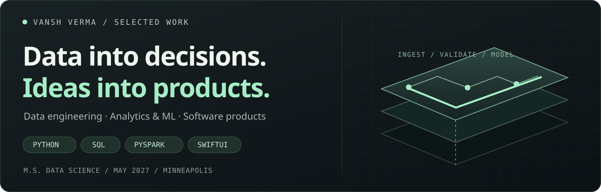
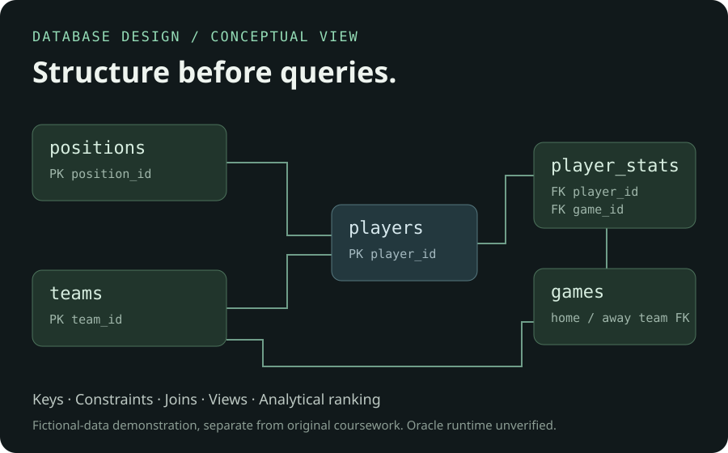
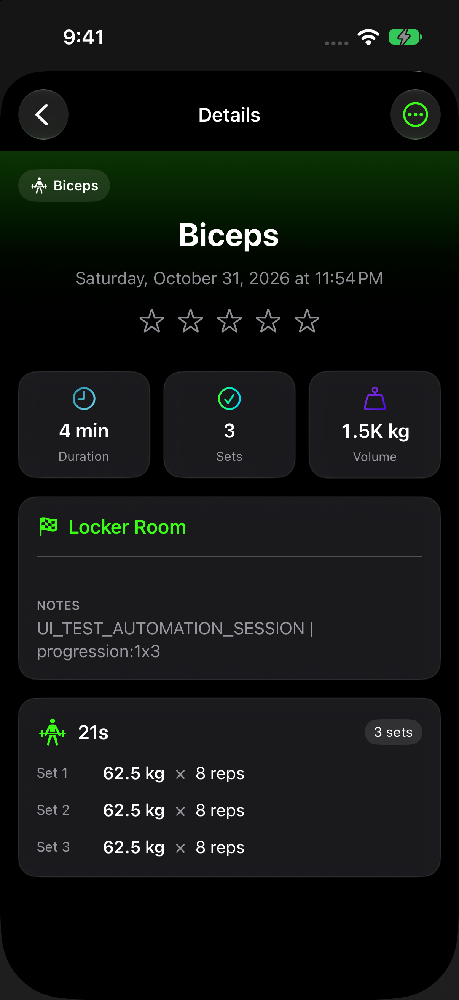
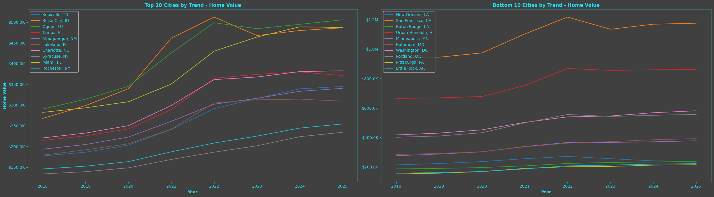
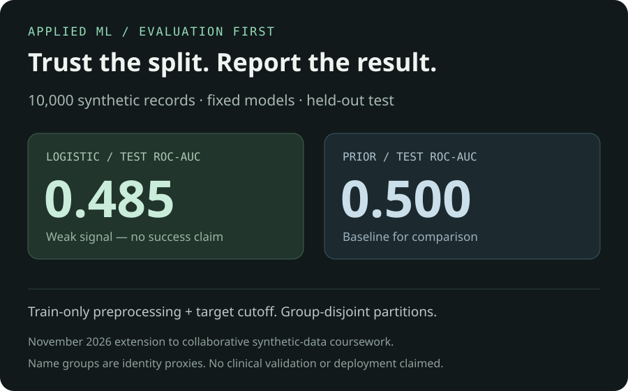
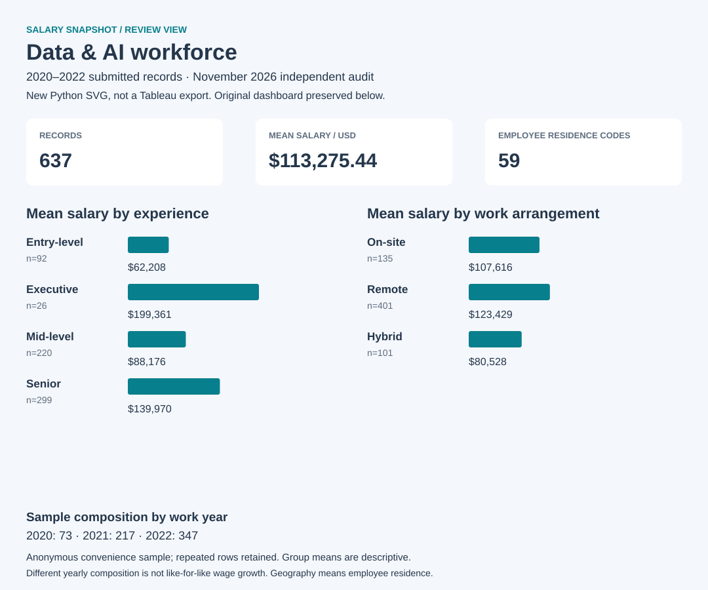
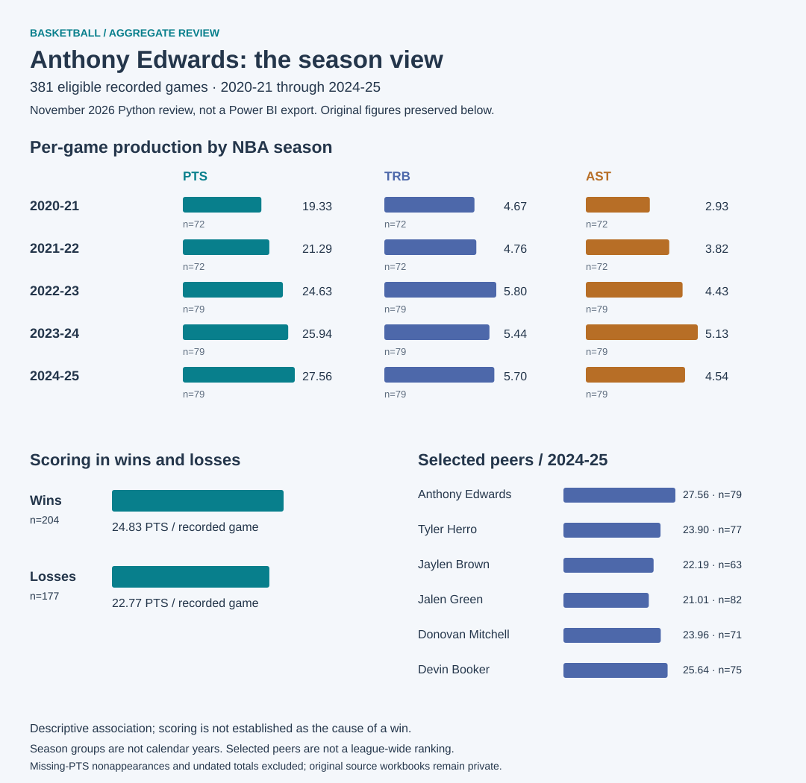

  

<a href="https://vanshverma0401-wq.github.io/vanshverma0401-wq/"><strong>EXPLORE THE PORTFOLIO ↗</strong></a> &nbsp; · &nbsp; <a href="https://www.linkedin.com/in/vansh-verma-403377333/">LinkedIn</a> &nbsp; · &nbsp; <a href="https://github.com/vanshverma0401-wq?tab=repositories">Repositories</a>

I build **Python/SQL data workflows**, investigate what the results actually support, and explore how software makes them useful. I am an **M.S. Data Science candidate at the University of St. Thomas**, with a **4.0/4.0 GPA** and expected graduation in **May 2027**. Seeking 2027 early-career data engineering, analytics, BI and software/product opportunities. Minneapolis; open to U.S. relocation.

<table><tr><td width="33%" align="center"><h2>23.9M</h2>review rows parsed Individual academic data lake</td><td width="34%" align="center"><h2>1.25M</h2>joined fragrance-review rows Verified historical execution</td><td width="33%" align="center"><h2>4.0 / 4.0</h2>M.S. GPA Expected May 2027</td></tr></table>

## Selected work

<table>
  <tr>
    <td width="50%" valign="top">
      01 / DATA ENGINEERING
      <h3><a href="https://github.com/vanshverma0401-wq/fragrance-data-lake-pyspark">Fragrance Data Lake ↗</a></h3>
      
      
From heterogeneous inputs to curated tables: ingestion, cleaning, joins, Parquet and data-quality checks.

      
<strong>PySpark · Spark SQL · Amazon S3 · ETL</strong>

      
Individual academic project. Chart: separate 30,046-record Parfumo branch, not the 23.9M Amazon-review branch. Public reconstruction has documented replay limits.

      <a href="https://github.com/vanshverma0401-wq/fragrance-data-lake-pyspark/tree/main/data/derived">Results</a> · <a href="https://github.com/vanshverma0401-wq/fragrance-data-lake-pyspark/tree/main/src">Code</a> · <a href="https://github.com/vanshverma0401-wq/fragrance-data-lake-pyspark/tree/main/examples/synthetic">Recovery demo</a>
    </td>
    <td width="50%" valign="top">
      02 / DATABASE DESIGN
      <h3><a href="https://github.com/vanshverma0401-wq/nba-oracle-relational-model">NBA Oracle Relational Model ↗</a></h3>
      
      
Model rosters, games and player statistics, then answer scoring and team-comparison questions.

      
<strong>Oracle SQL · Constraints · Joins · Views</strong>

      
Individual coursework. Original final DDL and fictional demonstration are separate. Diagram is conceptual; real Oracle execution remains unverified.

      <a href="https://github.com/vanshverma0401-wq/nba-oracle-relational-model/blob/main/coursework/final_schema.sql">Original DDL</a> · <a href="https://github.com/vanshverma0401-wq/nba-oracle-relational-model/blob/main/analysis_queries.sql">Queries</a> · <a href="https://github.com/vanshverma0401-wq/nba-oracle-relational-model/tree/main/verification">Assertions</a>
    </td>
  </tr>
  <tr>
    <td width="50%" valign="top">
      03 / PRODUCT ENGINEERING
      <h3><a href="https://github.com/vanshverma0401-wq/setflow-product-case-study">SetFlow ↗</a></h3>
      

      
A native strength-training app connecting planning, set logging, recovery and retained workout history.

      
<strong>SwiftUI · SwiftData · State · Local persistence</strong>

      
I direct product decisions and review; most app code was generated with substantial AI assistance. Private, in development, pre-beta. Screenshot: October 2026 synthetic Simulator evidence. No release or beta access.

      <a href="https://setflow-review-nov03.vanshverma0401.chatgpt.site/watch.html#momentum">94-second walkthrough</a> · <a href="https://github.com/vanshverma0401-wq/setflow-product-case-study/blob/main/EVIDENCE_AND_LIMITATIONS.md">Evidence</a>
    </td>
    <td width="50%" valign="top">
      04 / TIME-SERIES ANALYTICS
      <h3><a href="https://github.com/vanshverma0401-wq/zillow-housing-market-analysis">Zillow Housing Analysis ↗</a></h3>
      
      
Six business questions, 18 saved charts and a separate 50-metro benchmark with exact calendar targets and a purged time split.

      
<strong>Pandas · Keyed joins · scikit-learn · XGBoost</strong>

      
Collaborative with Jake Holley and Miranda Dahl. New Ridge benchmark is separate from the original neighborhood model and ROI scenarios. Revised historical data, not prospective or investment proof. Data Provided by Zillow Group.

      <a href="https://github.com/vanshverma0401-wq/zillow-housing-market-analysis/blob/main/FINAL_PROJECT.md">Final project</a> · <a href="https://github.com/vanshverma0401-wq/zillow-housing-market-analysis/blob/main/REPLAY_EXTENSION.md">New benchmark</a>
    </td>
  </tr>
  <tr>
    <td width="50%" valign="top">
      05 / APPLIED MACHINE LEARNING
      <h3><a href="https://github.com/vanshverma0401-wq/healthcare-ml-operations-analysis">Healthcare ML ↗</a></h3>
      
      
Preprocessing, feature engineering and model comparison, with a new group-disjoint billing evaluation that reports weak signal honestly.

      
<strong>scikit-learn · Pipelines · Baselines · Evaluation</strong>

      
Six-person synthetic-data coursework. I contributed cleaning, features, preprocessing, comparison, evaluation, documentation and presentation. New benchmark: 10,000 synthetic rows; name groups are identity proxies. No clinical validation.

      <a href="https://github.com/vanshverma0401-wq/healthcare-ml-operations-analysis/blob/main/FULL_BILLING_REPORT.md">Team analysis</a> · <a href="https://github.com/vanshverma0401-wq/healthcare-ml-operations-analysis/blob/main/REPLAY_EXTENSION.md">Evaluation extension</a>
    </td>
    <td width="50%" valign="top">
      06 / BUSINESS INTELLIGENCE
      <h3><a href="https://github.com/vanshverma0401-wq/ai-workforce-tableau-dashboard">Data &amp; AI Workforce ↗</a></h3>
      
      
Turn a 637-record historical salary snapshot into calculated fields, KPIs and comparative dashboard views.

      
<strong>Tableau · Tableau Prep · Calculated fields · KPIs</strong>

      
Collaborative with Denny Hoang; per-person task split undocumented. Data: 2020–2022. Visual: November 2026 Python review export. Native Tableau refresh remains unverified.

      <a href="https://github.com/vanshverma0401-wq/ai-workforce-tableau-dashboard/blob/main/FIGURE_GALLERY.md">Original gallery</a> · <a href="https://github.com/vanshverma0401-wq/ai-workforce-tableau-dashboard/tree/main/technical">Technical evidence</a>
    </td>
  </tr>
  <tr>
    <td width="50%" valign="top">
      07 / SPORTS ANALYTICS
      <h3><a href="https://github.com/vanshverma0401-wq/nba-bench-impact-analysis">NBA Bench Impact ↗</a></h3>
      
      
572 unique player records, a transparent 185-player cohort and four result charts with explicit qualification thresholds.

      
<strong>Pandas · Deduplication · Cohort design · Matplotlib</strong>

      
Individual analysis, 2023–24 regular season. Results depend on documented games and attempt thresholds. Source: Basketball-Reference / Sports Reference LLC.

      <a href="https://github.com/vanshverma0401-wq/nba-bench-impact-analysis">Charts and code</a> · <a href="https://github.com/vanshverma0401-wq/nba-bench-impact-analysis#more-result-charts">More results</a>
    </td>
    <td width="50%" valign="top">
      08 / REPORTING &amp; COMPARISON
      <h3><a href="https://github.com/vanshverma0401-wq/anthony-edwards-power-bi-dashboard">Anthony Edwards Dashboard ↗</a></h3>
      
      
Five seasons, 381 recorded games and a selected peer group, with season trends and separate win/loss averages.

      
<strong>Power BI · Power Query · Filtering · Data validation</strong>

      
Collaborative with Denny Hoang. Visual: November 2026 Python review export. Original nine report figures are available; native refresh and exact M/DAX/model details remain unverified.

      <a href="https://github.com/vanshverma0401-wq/anthony-edwards-power-bi-dashboard#complete-figure-gallery">Original figures</a> · <a href="https://github.com/vanshverma0401-wq/anthony-edwards-power-bi-dashboard/tree/main/technical">Checked aggregates</a>
    </td>
  </tr>
</table>

### A small tool that runs locally

<table><tr><td width="45%"></td><td valign="top"><h3><a href="https://github.com/vanshverma0401-wq/fragrance-wardrobe-intelligence">Fragrance Wardrobe Intelligence ↗</a></h3>
Local-first Python CLI for rotation, cost per logged wear, coverage and explainable heuristic matching.

<strong>Python · Data contracts · Validation · Deterministic JSON</strong>

Individual local MVP. Eight fictional items and 18 wear events; not a trained recommender or measured consumer outcome.
<a href="https://github.com/vanshverma0401-wq/fragrance-wardrobe-intelligence#run-it-locally">Run the demo</a></td></tr></table>

## Skills, connected to evidence

| Build data foundations | Analyze and validate | Build useful interfaces |
| --- | --- | --- |
| Python, SQL, PySpark, Spark SQL, Amazon S3, ETL, Parquet | Pandas, NumPy, scikit-learn, XGBoost, Tableau, Power BI | SwiftUI, SwiftData, local state, persistence, Python CLI |
| Ingestion, joins, constraints, data quality, replay and rollback examples | Cohort design, features, baselines, time splits, evaluation and reporting | Workflow decisions, input validation, session continuity and reviewed AI-assisted implementation |
| [Data lake](https://github.com/vanshverma0401-wq/fragrance-data-lake-pyspark) · [Oracle](https://github.com/vanshverma0401-wq/nba-oracle-relational-model) | [ML evaluation](https://github.com/vanshverma0401-wq/healthcare-ml-operations-analysis/blob/main/REPLAY_EXTENSION.md) · [BI](https://github.com/vanshverma0401-wq/ai-workforce-tableau-dashboard) | [SetFlow](https://github.com/vanshverma0401-wq/setflow-product-case-study) · [Local CLI](https://github.com/vanshverma0401-wq/fragrance-wardrobe-intelligence) |

At **Cognizant**, I completed Java/Spring/Angular training and contributed to team demos. At **Stibo Systems**, I worked in client technical support and issue investigation. Introductory Snowflake coursework is part of my learning background, separate from implemented project evidence.

<strong>Explore the details. Inspect the evidence. Start a conversation.</strong> <a href="https://vanshverma0401-wq.github.io/vanshverma0401-wq/">Personal portfolio</a> · <a href="https://www.linkedin.com/in/vansh-verma-403377333/">LinkedIn</a> · <a href="https://github.com/vanshverma0401-wq?tab=repositories">Repositories</a>

