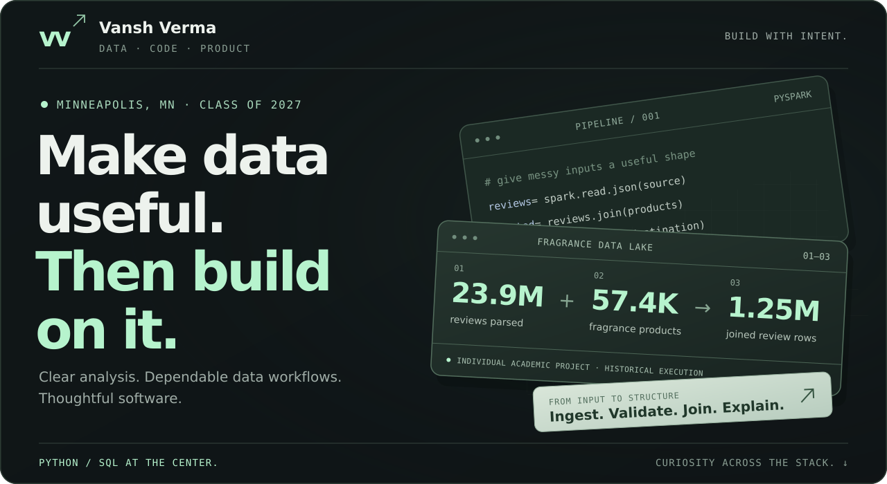
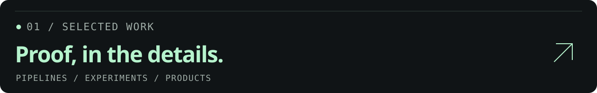
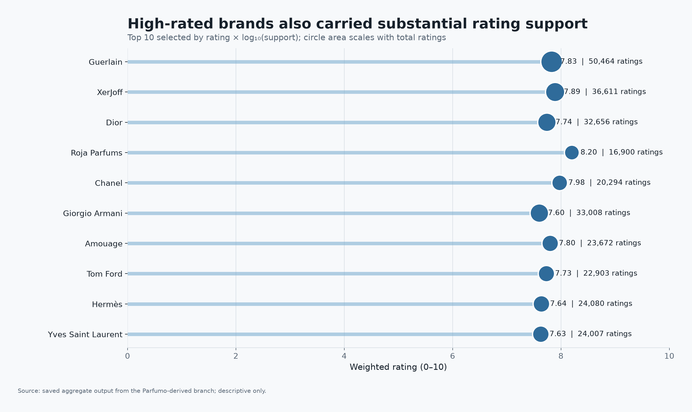
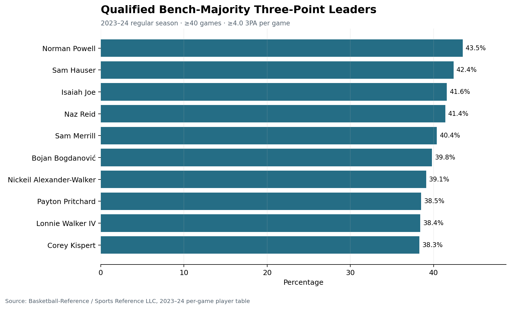
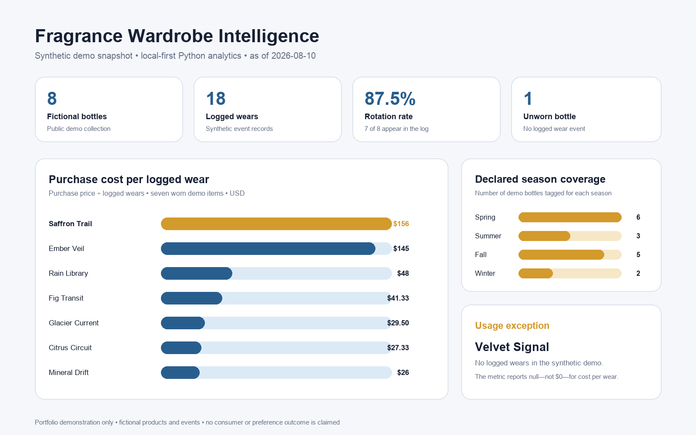
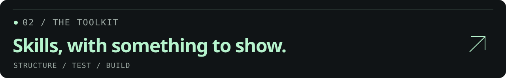
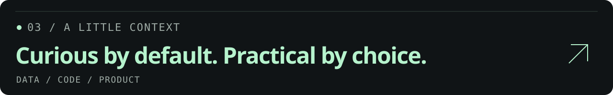

<picture>
  <source media="(max-width: 600px)" srcset="assets/profile/portfolio-hero-mobile.svg">
  
</picture>

<a href="#selected-work"><strong>01 &nbsp; Work ↓</strong></a> &nbsp; · &nbsp; <a href="#the-toolkit"><strong>02 &nbsp; Toolkit ↓</strong></a> &nbsp; · &nbsp; <a href="#about"><strong>03 &nbsp; About ↓</strong></a> &nbsp; · &nbsp; <a href="https://vanshverma0401-wq.github.io/vanshverma0401-wq/"><strong>Interactive portfolio ↗</strong></a>

I’m Vansh — an **M.S. Data Science candidate** turning messy inputs into clear analysis, dependable data workflows and thoughtful software. **Python and SQL at the center; curiosity across the rest of the stack.**

**University of St. Thomas · 4.0/4.0 GPA · Expected May 2027** 
Minneapolis, MN · Open to U.S. relocation · Seeking 2027 early-career opportunities.

## Selected work

<table>
<tr>
<td width="44%" valign="top">
01 / FEATURED · DATA ENGINEERING &amp; AI
<h2>Zomato AI Data Pipeline</h2>

Private S3 CSVs → Snowflake → tested dbt models, orchestrated through a manual Airflow workflow in Docker.

<h3>17 models · 28 passing data tests</h3>

10,000,000 generated orders 22,998,179 generated order items.

<strong>Python · SQL · Snowflake · dbt Airflow · Docker · Hosted OpenAI</strong>

<a href="https://github.com/vanshverma0401-wq/zomato-ai-data-pipeline"><strong>Inside the project ↗</strong></a> · <a href="https://github.com/vanshverma0401-wq/zomato-ai-data-pipeline/blob/main/docs/CASE_STUDY.md">Case study</a>
</td>
<td width="56%" valign="top">
VERIFIED WORKFLOW / SAVED EVIDENCE

<strong>Three AI features, with review gates.</strong> Structured review enrichment, hosted-embedding RAG with checked source IDs, and SQL generation → inspection → execution.

Guided implementation from <a href="https://www.youtube.com/watch?v=kYwaNMQ3XT8">Darshil Parmar’s tutorial</a>, developed with AI coding assistance. Orders, items and review texts are tutorial-generated. One manual replay verified; services shut down and cloud data copies removed afterward. Code and saved evidence remain available.

<a href="https://github.com/vanshverma0401-wq/zomato-ai-data-pipeline/blob/main/portfolio/README.md">Example gallery</a> · <a href="https://github.com/vanshverma0401-wq/zomato-ai-data-pipeline/blob/main/docs/VERIFICATION.md">Verification and limits</a>
</td>
</tr>
</table>

<table>
<tr>
<td width="44%" valign="top">
02 / FEATURED · DATA ENGINEERING
<h2>Fragrance Data Lake</h2>

Finding structure in millions of reviews. A PySpark and AWS S3 workflow for ingestion, cleaning, joins and curated analytical tables.

<h3>23.9M → 1.25M</h3>

Amazon review rows parsed → joined fragrance-review rows.

<strong>PySpark · Spark SQL · Amazon S3 ETL · Parquet · Data quality</strong>

<a href="https://github.com/vanshverma0401-wq/fragrance-data-lake-pyspark"><strong>Inside the project ↗</strong></a> · <a href="https://github.com/vanshverma0401-wq/fragrance-data-lake-pyspark/tree/main/src">Source code</a>
</td>
<td width="56%" valign="top">
VISUAL RESULT / SEPARATE PARFUMO BRANCH

<strong>What makes a fragrance stand out?</strong> Brand ratings, with the support behind each result.

Individual academic project. Chart: separate 30,046-record Parfumo branch. Pipeline scale reflects verified historical execution; the public reconstruction documents replay limits.

<a href="https://github.com/vanshverma0401-wq/fragrance-data-lake-pyspark/tree/main/data/derived">Derived results</a> · <a href="https://github.com/vanshverma0401-wq/fragrance-data-lake-pyspark/tree/main/examples/synthetic">Recovery demo</a>
</td>
</tr>
</table>

<table>
  <tr>
    <td width="50%" valign="top">
      03 / DATABASE DESIGN
      <h3><a href="https://github.com/vanshverma0401-wq/nba-oracle-relational-model">NBA Oracle Relational Model ↗</a></h3>
      
      
Model rosters, games and player statistics, then answer scoring and team-comparison questions.

      
<strong>Oracle SQL · Constraints · Joins · Views</strong>

      
Individual coursework. Original final DDL and fictional demonstration are separate. Diagram is conceptual; real Oracle execution remains unverified.

      <a href="https://github.com/vanshverma0401-wq/nba-oracle-relational-model/blob/main/coursework/final_schema.sql">Original DDL</a> · <a href="https://github.com/vanshverma0401-wq/nba-oracle-relational-model/blob/main/analysis_queries.sql">Queries</a> · <a href="https://github.com/vanshverma0401-wq/nba-oracle-relational-model/tree/main/verification">Assertions</a>
    </td>
    <td width="50%" valign="top">
      04 / PRODUCT ENGINEERING
      <h3><a href="https://github.com/vanshverma0401-wq/setflow-product-case-study">SetFlow ↗</a></h3>
      

      
A native strength-training app connecting planning, set logging, recovery and retained workout history.

      
<strong>SwiftUI · SwiftData · State · Local persistence</strong>

      
I direct product decisions and review; most app code was generated with substantial AI assistance. Private, in development, pre-beta. Screenshot: October 2026 synthetic Simulator evidence. No release or beta access.

      <a href="https://setflow-review-nov03.vanshverma0401.chatgpt.site/watch.html#momentum">94-second walkthrough</a> · <a href="https://github.com/vanshverma0401-wq/setflow-product-case-study/blob/main/EVIDENCE_AND_LIMITATIONS.md">Evidence</a>
    </td>
  </tr>
  <tr>
    <td width="50%" valign="top">
      05 / TIME-SERIES ANALYTICS
      <h3><a href="https://github.com/vanshverma0401-wq/zillow-housing-market-analysis">Zillow Housing Analysis ↗</a></h3>
      
      
Six business questions, 18 saved charts and a separate 50-metro benchmark with exact calendar targets and a purged time split.

      
<strong>Pandas · Keyed joins · scikit-learn · XGBoost</strong>

      
Collaborative with Jake Holley and Miranda Dahl. New Ridge benchmark is separate from the original neighborhood model and ROI scenarios. Revised historical data, not prospective or investment proof. Data Provided by Zillow Group.

      <a href="https://github.com/vanshverma0401-wq/zillow-housing-market-analysis/blob/main/FINAL_PROJECT.md">Final project</a> · <a href="https://github.com/vanshverma0401-wq/zillow-housing-market-analysis/blob/main/REPLAY_EXTENSION.md">New benchmark</a>
    </td>
    <td width="50%" valign="top">
      06 / APPLIED MACHINE LEARNING
      <h3><a href="https://github.com/vanshverma0401-wq/healthcare-ml-operations-analysis">Healthcare ML ↗</a></h3>
      
      
Preprocessing, feature engineering and model comparison, with a new group-disjoint billing evaluation that reports weak signal honestly.

      
<strong>scikit-learn · Pipelines · Baselines · Evaluation</strong>

      
Six-person synthetic-data coursework. I contributed cleaning, features, preprocessing, comparison, evaluation, documentation and presentation. New benchmark: 10,000 synthetic rows; name groups are identity proxies. No clinical validation.

      <a href="https://github.com/vanshverma0401-wq/healthcare-ml-operations-analysis/blob/main/FULL_BILLING_REPORT.md">Team analysis</a> · <a href="https://github.com/vanshverma0401-wq/healthcare-ml-operations-analysis/blob/main/REPLAY_EXTENSION.md">Evaluation extension</a>
    </td>
  </tr>
  <tr>
    <td width="50%" valign="top">
      07 / BUSINESS INTELLIGENCE
      <h3><a href="https://github.com/vanshverma0401-wq/ai-workforce-tableau-dashboard">Data &amp; AI Workforce ↗</a></h3>
      
      
Turn a 637-record historical salary snapshot into calculated fields, KPIs and comparative dashboard views.

      
<strong>Tableau · Tableau Prep · Calculated fields · KPIs</strong>

      
Collaborative with Denny Hoang; per-person task split undocumented. Data: 2020–2022. Visual: November 2026 Python review export. Original Tableau gallery is linked below; native refresh remains unverified.

      <a href="https://github.com/vanshverma0401-wq/ai-workforce-tableau-dashboard/blob/main/FIGURE_GALLERY.md">Original gallery</a> · <a href="https://github.com/vanshverma0401-wq/ai-workforce-tableau-dashboard/tree/main/technical">Technical evidence</a>
    </td>
    <td width="50%" valign="top">
      08 / SPORTS ANALYTICS
      <h3><a href="https://github.com/vanshverma0401-wq/nba-bench-impact-analysis">NBA Bench Impact ↗</a></h3>
      
      
572 unique player records, a transparent 185-player cohort and four result charts with explicit qualification thresholds.

      
<strong>Pandas · Deduplication · Cohort design · Matplotlib</strong>

      
Individual analysis, 2023–24 regular season. Results depend on documented games and attempt thresholds. Source: Basketball-Reference / Sports Reference LLC.

      <a href="https://github.com/vanshverma0401-wq/nba-bench-impact-analysis">Charts and code</a> · <a href="https://github.com/vanshverma0401-wq/nba-bench-impact-analysis#more-result-charts">More results</a>
    </td>
  </tr>
  <tr>
    <td width="50%" valign="top">
      09 / REPORTING &amp; COMPARISON
      <h3><a href="https://github.com/vanshverma0401-wq/anthony-edwards-power-bi-dashboard">Anthony Edwards Dashboard ↗</a></h3>
      
      
Five seasons, 381 recorded games and a selected peer group, with season trends and separate win/loss averages.

      
<strong>Power BI · Power Query · Filtering · Data validation</strong>

      
Collaborative with Denny Hoang. Visual: November 2026 Python review export. Original nine report figures are available; native refresh and exact M/DAX/model details remain unverified.

      <a href="https://github.com/vanshverma0401-wq/anthony-edwards-power-bi-dashboard#complete-figure-gallery">Original figures</a> · <a href="https://github.com/vanshverma0401-wq/anthony-edwards-power-bi-dashboard/tree/main/technical">Checked aggregates</a>
    </td>
    <td width="50%" valign="top">
10 / LOCAL SOFTWARE
<h3><a href="https://github.com/vanshverma0401-wq/fragrance-wardrobe-intelligence">Fragrance Wardrobe Intelligence ↗</a></h3>

A collection, made more useful. A local Python CLI for rotation, coverage, cost per logged wear and explainable heuristic matching.

<strong>Python · Data contracts · Validation · Deterministic JSON</strong>

Individual local MVP. Eight fictional items and 18 wear events; not a trained recommender or measured consumer outcome.

<a href="https://github.com/vanshverma0401-wq/fragrance-wardrobe-intelligence#run-it-locally">Run the local demo</a>
</td>
  </tr>
</table>

Every project links to its source, methods, attribution and verification limits. Click a visual to inspect the project or its full-size result.

## The toolkit

<table>
<tr>
<td width="33%" valign="top">
A / DATA ENGINEERING
<h3>Structure the data.</h3>

Ingest, clean, join and model.

<strong>Python · SQL PySpark · Spark SQL Amazon S3 · Snowflake · Parquet dbt · Airflow · Docker Oracle · Relational design ETL · Data quality</strong>

<a href="https://github.com/vanshverma0401-wq/zomato-ai-data-pipeline">Snowflake/dbt workflow ↗</a> <a href="https://github.com/vanshverma0401-wq/fragrance-data-lake-pyspark">PySpark pipeline ↗</a> <a href="https://github.com/vanshverma0401-wq/nba-oracle-relational-model">Relational model ↗</a>

</td>
<td width="34%" valign="top">
B / ML, ANALYTICS &amp; BI
<h3>Test the question.</h3>

Explore, establish a baseline and evaluate.

<strong>Pandas · NumPy scikit-learn · XGBoost Feature engineering Time-aware evaluation Tableau · Power BI</strong>

<a href="https://github.com/vanshverma0401-wq/zillow-housing-market-analysis/blob/main/REPLAY_EXTENSION.md">Time-split benchmark ↗</a> <a href="https://github.com/vanshverma0401-wq/healthcare-ml-operations-analysis/blob/main/REPLAY_EXTENSION.md">ML evaluation ↗</a>

</td>
<td width="33%" valign="top">
C / PRODUCT &amp; SOFTWARE
<h3>Build the experience.</h3>

Connect logic to a useful workflow.

<strong>SwiftUI · SwiftData Python command-line tools Local state · Persistence Input validation Hosted OpenAI · Embeddings RAG · SQL generation guards AI-assisted development &amp; review</strong>

<a href="https://github.com/vanshverma0401-wq/setflow-product-case-study">SetFlow case study ↗</a> <a href="https://github.com/vanshverma0401-wq/fragrance-wardrobe-intelligence">Local CLI ↗</a> <a href="https://github.com/vanshverma0401-wq/zomato-ai-data-pipeline/blob/main/docs/FEATURES.md">Hosted AI examples ↗</a>

</td>
</tr>
</table>

## About

I enjoy the full path from a messy dataset to an explanation someone can act on. Building **SetFlow** has pushed me to think carefully about product decisions, session state and human review of AI-assisted implementation.

At **Stibo Systems**, I worked in client technical support and issue investigation. My **Cognizant** background includes Java/Spring/Angular training, assessments and team demos. The Zomato project adds tutorial-derived Snowflake/dbt implementation, a verified Airflow replay and three bounded hosted-AI demonstrations.

**Good work starts with a conversation.** Exploring 2027 early-career opportunities in data engineering, analytics, BI and software products.

<a href="https://www.linkedin.com/in/vansh-verma-403377333/"><strong>Connect on LinkedIn ↗</strong></a> &nbsp; · &nbsp; <a href="https://vanshverma0401-wq.github.io/vanshverma0401-wq/">Interactive portfolio ↗</a> &nbsp; · &nbsp; <a href="https://github.com/vanshverma0401-wq?tab=repositories">Browse the repositories ↗</a>

BUILD WITH INTENT. VERIFY THE RESULT. &nbsp; / &nbsp; <a href="assets/profile/source-manifest.json">Visual sources &amp; attribution</a>
